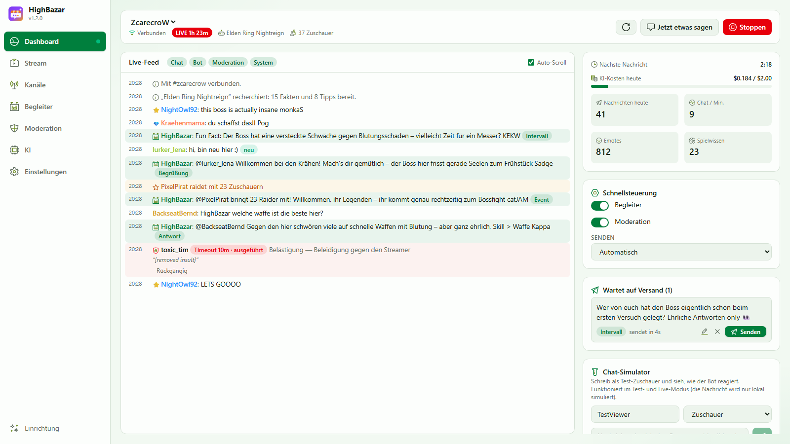

<div align="center">


# HighBazar

**Ein KI-Begleiter und fairer Moderator für deinen Twitch-Chat.**
Er chattet, begrüßt Neue, feiert deine Community, kennt dein Spiel – und hält den Chat sicher.

[**⬇ Download**](https://github.com/ZcarecroW/HighBazar/releases/latest) · [Funktionen](#funktionen) · [Installation](#installation) · [Schnellstart](#schnellstart) · [FAQ](#faq) · [🇬🇧 English](README.md)



</div>

---

## Was ist HighBazar?

HighBazar ist eine kleine Desktop-App, die neben deinem Stream läuft und Leben in deinen Chat bringt. Mit einem
KI-Modell deiner Wahl (Claude, GPT, Gemini, lokale Modelle und mehr) kann sie:

- **wie ein netter Stammzuschauer chatten** – alle paar Minuten sagt sie etwas Lustiges, Interessantes oder
  Mitreißendes, das zum Chat und zu deinem Spiel passt,
- **auf deine Community reagieren** – antwortet, wenn man sie anspricht, begrüßt Erstchatter, bedankt sich für
  Follows, Subs, Geschenke, Raids und Cheers,
- **dein Spiel kennen** – beim Kategoriewechsel recherchiert sie Fakten und Tipps (Wikipedia + Websuche),
- **fair moderieren** – sofortige lokale Regeln plus kontextbewusste KI, die Spaß von echtem Hass unterscheidet.

Gemacht für **kleine Streamer**, die vom ersten Zuschauer an einen lebendigen Chat wollen – und skalierbar für
**große Kanäle** dank adaptivem Timing, Bündelung und Budgets.

Standardmäßig schreibt der Bot mit **deinem Streamer-Account** (mit einstellbarem Präfix wie `[HighBazar]`) oder
mit einem **eigenen Bot-Account**, wenn du einen verbindest.

## Funktionen

### 🤖 Begleiter
- **Intervall-Nachrichten** mit Zufallsintervall (z. B. alle 3–5 Min.), nur während des Streams, adaptiv: weniger, wenn der Chat brummt; Pause, wenn niemand antwortet.
- **Themen-Mix**: auf den Chat reagieren · Spiel-Fakten · Tipps · Trivia · Witze · Fragen an den Chat · Hype · Stream-Momente – jeweils gewichtet.
- **Kontext**: die letzten *N* Chatnachrichten (einstellbar), Titel, Kategorie, Laufzeit, Zuschauer und was du der KI über deinen Stream erzählst.
- **Persönlichkeit**: Beschreibung plus Regler für Humor, Energie und Frechheit, eigene Anweisungen, Tabuthemen. Sieben Vorlagen.
- **Sprache**: Stream-Sprache, feste Sprache oder die Sprache der meisten Chatter – optional antwortet sie jedem in *seiner* Sprache.
- **Emotes**: kennt die Twitch-, **BetterTTV**-, **FrankerFaceZ**- und **7TV**-Emotes deines Kanals und bevorzugt die, die deine Community wirklich nutzt.
- **Reaktionen**: auf Ansprache, Erstchatter, Follows (gesammelt), Subs, Resubs, Sub-Geschenke, Raids (inkl. was der Raider gespielt hat) und Cheers.
- **Befehle**: `!hb ask <Frage>`, `!hb fact`, `!hb joke`, `!hb about` – mit Cooldowns und Rollen.
- **Spielrecherche**: beim Kategoriewechsel Wikipedia + Websuche des KI-Anbieters → Fakten & Tipps, pro Spiel zwischengespeichert.
- **Kontrolle**: automatisch senden, *Vorschau dann senden* oder *jede Nachricht freigeben*; „Jetzt etwas sagen“; Tagesbudget.

### 🛡️ Moderation
- **Sofort-Regeln** (kostenlos, ohne KI): gesperrte Begriffe mit `*`-Platzhaltern und Leetspeak-Erkennung, Links mit Erlaubt-Liste, Großschreibung, Wiederholungen, Emote-Spam, Länge.
- **KI-Einstufung mit Kontext** (gebündelt) in neun Kategorien: Hass, Belästigung, Drohungen, sexuelle Inhalte, Selbstverletzung, Spam, Betrug, Doxxing, Extremismus.
- **Aktionen je Kategorie** für *eindeutige* Verstöße und *Grenzfälle*: nichts, protokollieren, löschen, verwarnen, Timeout (beliebig lang), Bann.
- **Eskalation** bei Wiederholungstätern, **Ausnahmen** (Mods, VIPs, Subs, bestimmte Nutzer), Kanalregeln in normaler Sprache, Strenge-Regler, Mindestsicherheit.
- **Modi**: aus · beobachten · Aktionen vorschlagen (ein Klick zum Ausführen) · automatisch. **Moderationsprotokoll mit Rückgängig**.
- Vorlagen: **Ausgewogen** (Standard – greift nur bei eindeutigen Fällen), Locker, Familienfreundlich, Nur Vorschläge, Nur beobachten.

### 🧠 KI-Anbieter
Anthropic Claude · OpenAI · Google Gemini · OpenRouter · Mistral · Groq · xAI · DeepSeek · Perplexity · Together AI ·
**Ollama** und **LM Studio** (lokal, kostenlos) · beliebige OpenAI-kompatible Endpunkte · optional die **Claude Code CLI**
(siehe [FAQ](#kann-ich-mein-claude-pro-abo-nutzen)). Alles über **KI-Profile** einstellbar (Modell, Denkaufwand,
Tokens, Temperatur, Timeout, Preise, Header …) – inkl. Modell-Liste laden, Verbindungstest und Kostenanzeige. Für die
Moderation kannst du ein **günstigeres Modell** wählen.

### 🎛️ Stream & Kanal verwalten
Ändere deinen Stream direkt in HighBazar, in drei Stufen (Standard: *Einfach*):
- **Einfach** – Titel, Kategorie (Suche mit Cover), Sprache und Tags.
- **Erweitert** – zusätzlich Inhaltskennzeichnungen und Markeninhalte, Chat-Einstellungen (Nur Emotes, Nur Follower, langsamer Modus, Nur Abos, einzigartiger Chat, Chat-Verzögerung), Ankündigungen, Shoutouts, Raids, Clips (mit Titel und Länge), Stream-Marker und angepinnte Chat-Nachrichten.
- **Experte** – alles, was Twitch erlaubt: Umfragen (mit Kanalpunkte-Stimmen) und Vorhersagen, Kanalpunkte-Belohnungen mit Limits, Mods, VIPs, Sperren und Entbannungs-Anträge, Überwachung verdächtiger Accounts, Twitch-AutoMod, Schild-Modus und gesperrte Begriffe, Werbung (starten/verschieben), Zeitplan, Stream-Verzögerung (Partner), Kanalbeschreibung und Chat-Farbe, Follower- und Abo-Zahlen sowie der Hype-Train.

HighBazar fragt bei Twitch nur die Berechtigungen der gewählten Stufe an; beim Wechsel auf eine höhere Stufe bestätigst du die zusätzlichen einmal.

### 🎨 10 Themes, hell und dunkel
Bazaar, Mitternacht, Ozean, Polarlicht, Wald, Gold, Abendrot, Karmesin, Sakura und Cyber – jeweils in einer hellen und einer dunklen Variante (oder automatisch wie das System). Alle Themes sind auf gut lesbare Kontraste geprüft (WCAG AA); die zweifarbigen Icons übernehmen die Farben des Themes.

### 🧩 Profile überall
- **Kanalprofile** (globale Profile) – eins pro Twitch-Kanal oder Setup, jederzeit umschaltbar.
- **Begleiter-, Moderations- und KI-Profile** – Vorlagen sind schreibgeschützt und werden mit Updates besser; duplizieren und anpassen oder neu anlegen.

### ✨ Außerdem
Einrichtungsassistent (überspringbar, jederzeit wieder aufrufbar) · Testmodus mit Chat-Simulator · Live-Feed mit
Löschen/Timeout/Bann per Klick · Emotes von Twitch, BTTV, FFZ und 7TV als Bilder (abschaltbar) · Designs System/Dunkel/Hell · Deutsch & Englisch · für 1920×1080 optimiert und
responsiv · automatische Updates über GitHub · schlanker Rust-Kern statt Electron.

## Installation

Lade die passende Datei aus dem **[neuesten Release](https://github.com/ZcarecroW/HighBazar/releases/latest)**:

| System | Datei | Hinweise |
|---|---|---|
| **Windows 10/11** | `HighBazar_x.y.z_x64-setup.exe` | Installation für den aktuellen Nutzer, keine Adminrechte nötig. |
| **macOS 11+** (Apple Silicon & Intel) | `HighBazar_x.y.z_universal.dmg` | DMG öffnen, HighBazar in *Programme* ziehen. |
| **Linux** | `.AppImage`, `.deb` oder `.rpm` | Das AppImage läuft überall und aktualisiert sich selbst. |

**Windows-SmartScreen-Warnung:** Die App ist Open Source, aber nicht mit einem kostenpflichtigen Zertifikat signiert.
Klicke auf **Weitere Informationen → Trotzdem ausführen**.

**macOS „beschädigt“:** Die App ist nicht von Apple notarisiert. Einmal im Terminal ausführen:

```bash
xattr -cr /Applications/HighBazar.app
```

## Schnellstart

1. **HighBazar starten** – der Einrichtungsassistent öffnet sich.
2. **Twitch verbinden** – auf *Verbinden* klicken und den angezeigten Code auf `twitch.tv/activate` eingeben. HighBazar sieht nie dein Passwort.
3. *(Optional)* **Bot-Account verbinden** – sonst schreibt der Bot mit deinem Account und Präfix.
4. **KI wählen**, API-Schlüssel einfügen (oder ein lokales Modell wählen) → *Verbindung testen*.
5. **Begleiter-Stil** und **Moderationsprofil** wählen, optional der KI etwas über deinen Stream erzählen.
6. **Im Testmodus ausprobieren**: Chat-Simulator nutzen, den Bot ansprechen, `!hb ask …` tippen, einen Raid simulieren.
7. **Bot starten** und streamen. 🎉

## Kosten

HighBazar selbst ist kostenlos. Die KI-Anbieter rechnen direkt mit dir ab; das Dashboard zeigt die Kosten des Tages,
und pro Kanal gibt es ein **Tagesbudget** (Standard 2 $). Grobe Größenordnung pro Streamstunde mit Standardeinstellungen:
kleine Modelle (Claude Haiku 5.5, GPT‑6 Luna) **unter 0,02 $**, mittlere (Claude Sonnet 5.5, GPT‑6.1 Sol, Gemini 3.8 Flash)
**etwa 0,10–0,25 $**, Claude Opus 5.5 **etwa 0,20–0,50 $**, lokale Modelle **0 $** – plus KI-Moderation, je nach Chat-Aktivität.
*Schätzwerte.* Tipp: ein starkes Modell für den Begleiter, ein schnelles günstiges für die Moderation.

## FAQ

### Kann ich mein Claude-Pro-Abo nutzen?
Drittanbieter-Apps dürfen sich nicht mit einem Claude.ai-Abo anmelden; der offizielle Weg ist ein **API-Schlüssel** aus der
[Claude Console](https://platform.claude.com) (Abrechnung nach Nutzung – mit Haiku Bruchteile eines Cents pro Nachricht).
*Optional* kann HighBazar deine lokal installierte, angemeldete **Claude Code CLI** (`claude -p`) nutzen, die über dein Abo läuft.
Ob ein dauerhaft laufender Chat-Bot von den Abo-Bedingungen gedeckt ist, liegt in deiner Verantwortung.

### Gibt sich der Bot als ich aus?
Nein. Nachrichten über deinen Account tragen das Präfix (Standard `[HighBazar]`), und die KI ist angewiesen, nie in deinem
Namen zu sprechen. Alternativ verbindest du einen eigenen Bot-Account.

### Spammt der Bot meinen Chat zu?
Nein: Intervall-Nachrichten kommen standardmäßig alle 3–5 Minuten, pausieren bei sehr aktivem Chat und nach einigen
unbeantworteten Nachrichten und laufen nur, wenn du live bist. Antworten und Begrüßungen haben Cooldowns und Limits.

### Wie streng ist die Standard-Moderation?
Das Profil *Ausgewogen* greift automatisch nur bei **eindeutigem** Hass, Belästigung, Drohungen, Betrug und Spam (löschen oder
Timeout, bei Wiederholung schärfer). Fluchen, Frotzeleien, schwarzer Humor und Kritik bleiben erlaubt; Grenzfälle werden nur
protokolliert. Mods und VIPs sind ausgenommen.

### Wo liegen meine Daten?
Alles bleibt auf deinem Rechner: Einstellungen im App-Ordner, API-Schlüssel und Twitch-Tokens im sicheren Anmeldespeicher deines
Systems. Chatnachrichten gehen nur an den KI-Anbieter, den du gewählt hast.

## Selbst bauen

Voraussetzungen: [Rust](https://rustup.rs), [Node.js](https://nodejs.org) LTS und die
[Tauri-Voraussetzungen](https://v2.tauri.app/start/prerequisites/).

```bash
git clone https://github.com/ZcarecroW/HighBazar.git
cd HighBazar
npm install
npm run tauri dev
```

## Lizenz

[MIT](LICENSE) © ZcarecroW. HighBazar steht in keiner Verbindung zu Twitch, Anthropic, OpenAI, Google oder anderen Anbietern.

Icons: [Nucleo](https://nucleoapp.com) – für HighBazar lizenziert und **nicht** Teil der MIT-Lizenz; sie dürfen nicht herausgelöst oder als Icon-Set weiterverwendet werden (src/icons/nucleo.ts).
