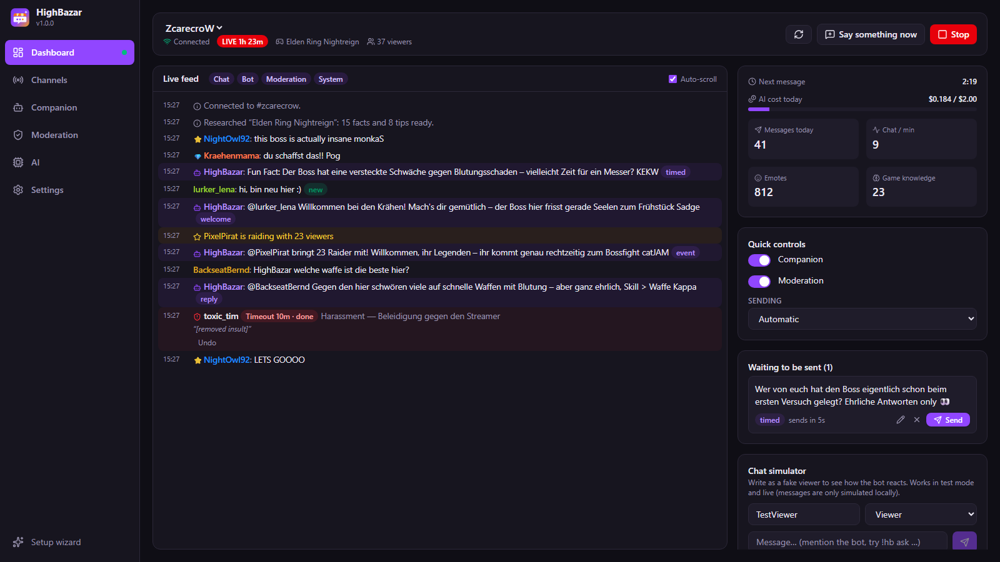
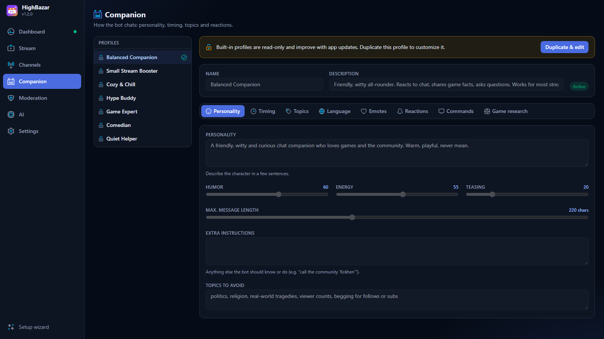
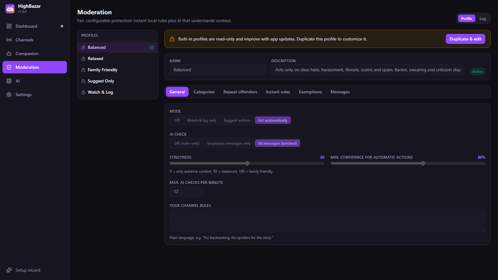
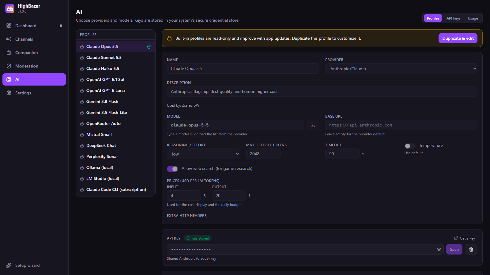
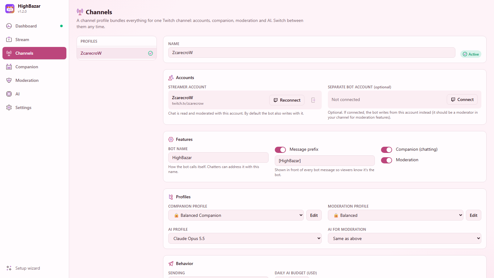
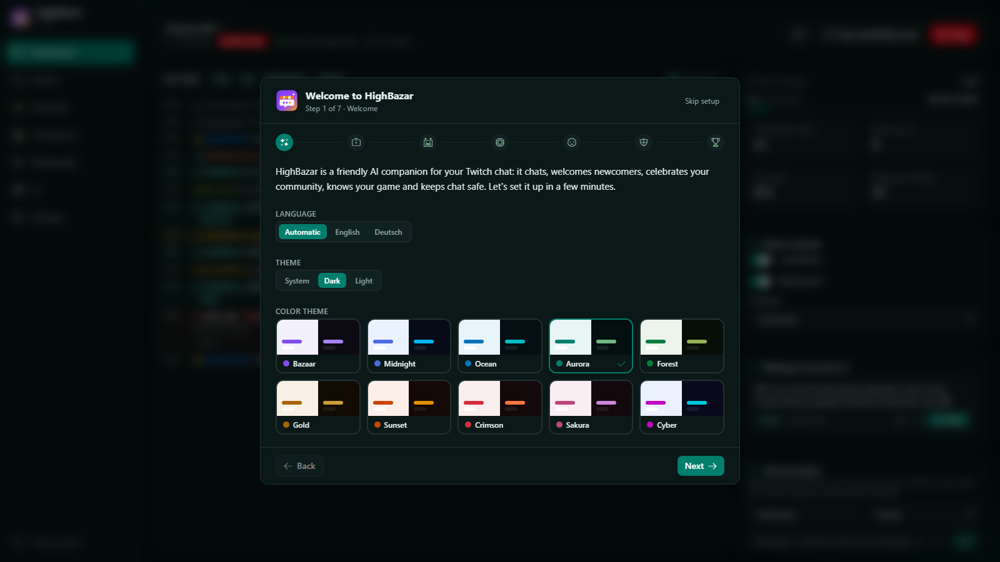

<div align="center">


# HighBazar

**An AI companion and fair moderator for your Twitch chat.**
It chats, welcomes newcomers, celebrates your community, knows your game — and keeps chat safe.

[](https://github.com/ZcarecroW/HighBazar/releases/latest)
[](LICENSE)


[**⬇ Download**](https://github.com/ZcarecroW/HighBazar/releases/latest) · [Features](#features) · [Installation](#installation) · [Quick start](#quick-start) · [FAQ](#faq) · [🇩🇪 Deutsch](README.de.md)



</div>

---

## What is HighBazar?

HighBazar is a small desktop app that sits next to your stream and brings life into your chat. It uses
an AI model of your choice (Claude, GPT, Gemini, local models and more) to:

- **chat like a friendly regular** — every few minutes it says something fun, interesting or engaging
  that fits what's happening in chat and in your game,
- **react to your community** — answers when addressed, welcomes first-time chatters, thanks follows,
  subs, gifts, raids and cheers,
- **know your game** — when you switch categories it researches facts and tips (Wikipedia + web search),
- **moderate fairly** — instant local rules plus context-aware AI that tells banter from real hate.

It's built for **small streamers** who want a lively chat from the first viewer on — and it scales to
**big channels** with adaptive pacing, batching and budgets.

The bot writes with **your streamer account** by default (marked with a configurable prefix like
`[HighBazar]`), or with a **separate bot account** if you connect one.

## Features

### 🤖 Companion
| | |
|---|---|
| **Timed messages** | Random interval (e.g. every 3–5 min), only while live, adaptive: talks less when chat is busy, pauses when nobody answers. |
| **Content mix** | React to chat · game facts · game tips · trivia · jokes · questions to chat · hype · stream moments — each with its own weight. |
| **Context-aware** | Reads the last *N* chat messages (configurable), stream title, category, uptime and viewers, plus everything you tell it about your stream. |
| **Personality** | Persona text plus humor / energy / teasing sliders, custom instructions and topics to avoid. Seven built-in presets. |
| **Language** | Stream language, a fixed language, or whatever most chatters use. Optionally answers each chatter in *their* language. |
| **Emotes** | Knows Twitch, **BetterTTV**, **FrankerFaceZ** and **7TV** emotes of your channel and prefers the ones your community actually uses. |
| **Reactions** | Replies when addressed, welcomes first-time chatters, thanks follows (batched), subs, resubs, gift subs, raids (mentions what the raider played) and cheers. |
| **Commands** | `!hb ask <question>`, `!hb fact`, `!hb joke`, `!hb about` — cooldowns and role requirements per command. |
| **Game research** | On category change: Wikipedia + the AI provider's web search → 15 facts & 8 tips, cached per game. |
| **Control** | Automatic sending, *preview then send*, or *approve every message*. "Say something now" button. Daily AI budget. |

### 🛡️ Moderation
- **Instant local rules** (free, no AI): blocked terms with `*` wildcards and leetspeak detection, links with allow-list, caps, repeated messages, emote spam, length.
- **AI classification** that understands context — batched for efficiency — in nine categories: hate, harassment, threats, sexual content, self-harm, spam, scams, doxxing, extremism.
- **Actions per category** for *clear* violations and *borderline* cases: nothing, log, delete, warn, timeout (any duration), ban.
- **Escalation** for repeat offenders, **exemptions** (mods, VIPs, subs, specific users), channel rules in plain language, strictness slider, confidence threshold.
- **Modes**: off · watch & log · suggest actions (one click to apply) · act automatically. Full **moderation log with undo**.
- Built-in profiles: **Balanced** (default – acts only on clear cases), Relaxed, Family Friendly, Suggest Only, Watch & Log.

### 🧠 AI providers
| Provider | Notes |
|---|---|
| **Anthropic Claude** | Messages API, prompt caching, web search for research. Presets: Opus 5.5, Sonnet 5.5, Haiku 5.5. |
| **OpenAI** | Responses API (or Chat Completions). Presets: GPT‑6.1 Sol, GPT‑6 Luna. |
| **Google Gemini** | Interactions API with automatic fallback to generateContent, Google Search grounding. |
| **OpenRouter** | One key for hundreds of models, exact cost reporting, web plugin. |
| **Mistral, Groq, xAI, DeepSeek, Perplexity, Together AI** | Via their OpenAI-compatible endpoints. |
| **Ollama, LM Studio** | Local models, free, nothing leaves your PC (except Twitch). |
| **Any OpenAI-compatible endpoint** | Custom base URL and headers. |
| **Claude Code CLI** *(optional)* | Uses your locally installed, logged-in `claude` CLI and thus your Claude subscription. See the [note below](#can-i-use-my-claude-pro-subscription). |

Every provider is configured through **AI profiles** (model, reasoning effort, max tokens, temperature, timeout,
prices, extra headers…). Load the model list from the provider, test the connection, see tokens and costs.
You can use a **different, cheaper model for moderation**.

### 🎛️ Stream & channel manager
Change your stream right from HighBazar, in three levels (default: *Simple*):
- **Simple** — title, category (search with box art), language and tags.
- **Advanced** — plus content classification labels and branded content, chat settings (emote-only, followers-only, slow mode, subs-only, unique chat, chat delay), announcements, shoutouts, raids, clips and stream markers.
- **Expert** — everything Twitch allows: polls and predictions, channel point rewards, mods, VIPs and bans, Twitch AutoMod levels, shield mode and blocked terms, ads (run / snooze), stream schedule, channel description and chat color, follower/sub numbers.

HighBazar only asks Twitch for the permissions of the level you pick; switching to a higher level asks you to approve the extra ones once.

### 🧩 Profiles everywhere
- **Channel profiles** (global profiles) — one per Twitch channel or setup, each with its own accounts, prefix, companion, moderation and AI profiles. Switch any time.
- **Companion, moderation and AI profiles** — built-in presets are read-only and improve with updates; duplicate one and make it yours, or start from scratch.

### ✨ And also
- **Setup wizard** on first start (skippable, can be reopened any time).
- **Test mode + chat simulator** — try everything without sending anything to Twitch.
- **Live feed** with chat, bot messages, events and moderation; delete / timeout / ban with one click. Twitch, BetterTTV, FrankerFaceZ and 7TV **emotes are shown as images** (can be switched off).
- **System, Dark and Light** themes, **English and German** UI, responsive layout optimized for 1920×1080.
- **Automatic updates** from GitHub Releases (check on start, configurable).
- **Lightweight**: native Rust core and the system's own webview instead of Electron; small installers.

<details>
<summary><b>More screenshots</b></summary>

| | |
|---|---|
|  |  |
|  |  |
|  |  |

</details>

## Installation

Download the file for your system from the **[latest release](https://github.com/ZcarecroW/HighBazar/releases/latest)**:

| System | File | Notes |
|---|---|---|
| **Windows 10/11** | `HighBazar_x.y.z_x64-setup.exe` | Installs for the current user, no admin rights needed. |
| **macOS 11+** (Apple Silicon & Intel) | `HighBazar_x.y.z_universal.dmg` | Open the DMG and drag HighBazar into *Applications*. |
| **Linux** | `.AppImage`, `.deb` or `.rpm` | AppImage works everywhere and supports auto-updates. |

<details>
<summary><b>Windows: "Windows protected your PC"</b></summary>

HighBazar is open source but not signed with a paid code-signing certificate, so SmartScreen may warn you.
Click **More info → Run anyway**. You can verify the download against the source on GitHub.
</details>

<details>
<summary><b>macOS: "HighBazar is damaged and can't be opened"</b></summary>

The app isn't notarized by Apple (that requires a paid developer account). After moving it to *Applications*, run once in Terminal:

```bash
xattr -cr /Applications/HighBazar.app
```

Then open it normally.
</details>

<details>
<summary><b>Linux</b></summary>

```bash
chmod +x HighBazar_*.AppImage
./HighBazar_*.AppImage
```

or install the `.deb` (`sudo apt install ./HighBazar_*.deb`) / `.rpm` (`sudo dnf install ./HighBazar-*.rpm`).
API keys are stored via the Secret Service (GNOME Keyring, KWallet…). Without one, HighBazar falls back to a
file in its data folder that only your user can read.
</details>

## Quick start

1. **Start HighBazar** — the setup wizard opens.
2. **Connect Twitch** — click *Connect*, enter the shown code on `twitch.tv/activate`. HighBazar never sees your password.
3. *(Optional)* **Connect a bot account** — otherwise the bot writes with your account and the prefix.
4. **Pick an AI** and paste an API key (or choose a local model) → *Test connection*.
5. **Pick a companion style** and a **moderation profile**, optionally tell the AI a bit about your stream.
6. **Try it in test mode**: use the chat simulator, mention the bot, type `!hb ask …`, simulate a raid.
7. **Start the bot** and stream. 🎉

## Costs

HighBazar itself is free. AI providers bill you directly; the dashboard shows today's cost and you can set a
**daily budget** per channel (default $2). Rough orders of magnitude for one hour of streaming with default
settings (~15 timed messages, a few replies and welcomes):

| Model class | Companion / hour | AI moderation / hour (moderate chat) |
|---|---|---|
| Small models (Claude Haiku 5.5, GPT‑6 Luna, Gemini Flash-Lite) | < $0.02 | < $0.02 |
| Mid models (Claude Sonnet 5.5, GPT‑6.1 Sol, Gemini 3.8 Flash) | ~ $0.10–0.25 | ~ $0.10–0.30 |
| Flagships (Claude Opus 5.5) | ~ $0.20–0.50 | use a small model for moderation |
| Local (Ollama / LM Studio) | $0 | $0 |

*Estimates — actual costs depend on chat activity, context size and prices.* Tip: use a great model for the
companion and a fast, cheap one for moderation (Channels → *AI for moderation*).

## FAQ

<details>
<summary><b>Can I use my Claude Pro subscription?</b></summary>

Third-party apps may not sign in with a Claude.ai subscription; the official way is an **API key** from the
[Claude Console](https://platform.claude.com) (pay per use — Haiku costs fractions of a cent per message).
As an *optional* alternative, HighBazar can call your locally installed and logged-in **Claude Code CLI**
(`claude -p`), which runs on your subscription. Whether an always-on chat bot is covered by your plan's terms
is your responsibility — the API key route is the supported one.
</details>

<details>
<summary><b>Does the bot pretend to be me?</b></summary>

No. Messages sent through your account carry the prefix (default `[HighBazar]`), and the AI is instructed
never to speak in your name. You can also connect a separate bot account.
</details>

<details>
<summary><b>Will it spam my chat?</b></summary>

Timed messages are spread out (default 3–5 min), pause when chat is very busy, stop after a few messages without
any answer, and only run while you're live. Replies and welcomes have cooldowns and rate limits.
</details>

<details>
<summary><b>How strict is the default moderation?</b></summary>

The *Balanced* profile only acts automatically on **clear** hate, harassment, threats, scams and spam (delete or
timeout, escalating for repeat offenders). Swearing, banter, dark humor and criticism are allowed; borderline cases
are only logged for you. Mods and VIPs are exempt. Try *Suggest Only* if you want to approve every action.
</details>

<details>
<summary><b>Where is my data stored?</b></summary>

Everything stays on your computer: settings in the app config folder, API keys and Twitch tokens in your OS
credential store (Windows Credential Manager, macOS Keychain, Secret Service). Chat messages are only sent to
the AI provider you chose. *Settings → Open data folder* shows the location.
</details>

<details>
<summary><b>The bot doesn't react to follows / can't moderate</b></summary>

Reconnect the streamer account in *Channels* (it needs the moderation and follower scopes). If you use a separate
bot account for writing, moderation still runs through the streamer account.
</details>

<details>
<summary><b>Can I use my own Twitch application?</b></summary>

Yes: register a **Public** application on [dev.twitch.tv](https://dev.twitch.tv/console) (category *Chat Bot*,
any redirect URL such as `http://localhost:17563`) and paste its Client ID under *Settings → Advanced*.
</details>

## Building from source

Requirements: [Rust](https://rustup.rs) (stable), [Node.js](https://nodejs.org) LTS and the
[Tauri prerequisites](https://v2.tauri.app/start/prerequisites/) for your OS.

```bash
git clone https://github.com/ZcarecroW/HighBazar.git
cd HighBazar
npm install
npm run tauri dev     # run in development mode
npm run tauri build   # build installers into src-tauri/target/release/bundle
```

`npm run dev` alone serves the UI in a normal browser with a mocked backend (handy for UI work:
`http://localhost:1420/?demo`). Tests: `cargo test --manifest-path src-tauri/Cargo.toml`.

### Tech stack

| Layer | Technology |
|---|---|
| App shell | Tauri 2.12 (Rust 2024 edition) |
| Core | Rust: tokio, reqwest (rustls), tokio-tungstenite, keyring |
| UI | Vue 3.5, Pinia 4, vue-i18n 11, Tailwind CSS 4.3, Vite 8, TypeScript 6 |
| Twitch | Device Code Flow, EventSub WebSocket, Helix API |
| Updates | Tauri updater with signed GitHub release artifacts |

### Project layout

```
src/                 Vue UI (views, components, stores, i18n)
src-tauri/src/
  ai/                provider clients (Anthropic, OpenAI, Gemini, OpenAI-compatible, Claude CLI)
  bot/               engine, prompts, moderation, research, usage
  twitch/            auth (device code), Helix, EventSub, emotes
  config/            settings, profiles and built-in presets
```

## Contributing

Issues and pull requests are welcome! Please describe what you changed and run the tests before opening a PR.

## License

[MIT](LICENSE) © ZcarecroW. HighBazar is not affiliated with Twitch, Anthropic, OpenAI, Google or any other provider.
